이번에 카카오와 배민에서 컨퍼런스를 하길래 처음으로 컨퍼런스라는것을 신청하게되었는데,<br>
아쉽게도 카카오는 떨어졌지만, 배민은 운이 좋게도 한번에 되어서 2026 우아콘을 다녀오게되었다

<br>

<p align="center">
  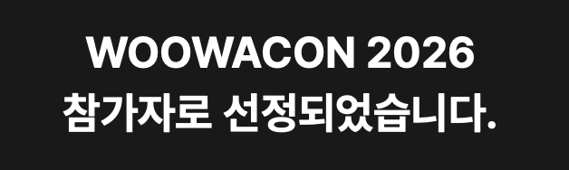
</p>

<br>
<br>

처음 입장부터 이런 대형 IT회사의 컨퍼런스는 어떨까 했는데,<br>
들어갈때부터 배민 컨퍼런스에 왔구나 하고 느껴지는 입장길이였다.

<br>

<p align="center">
  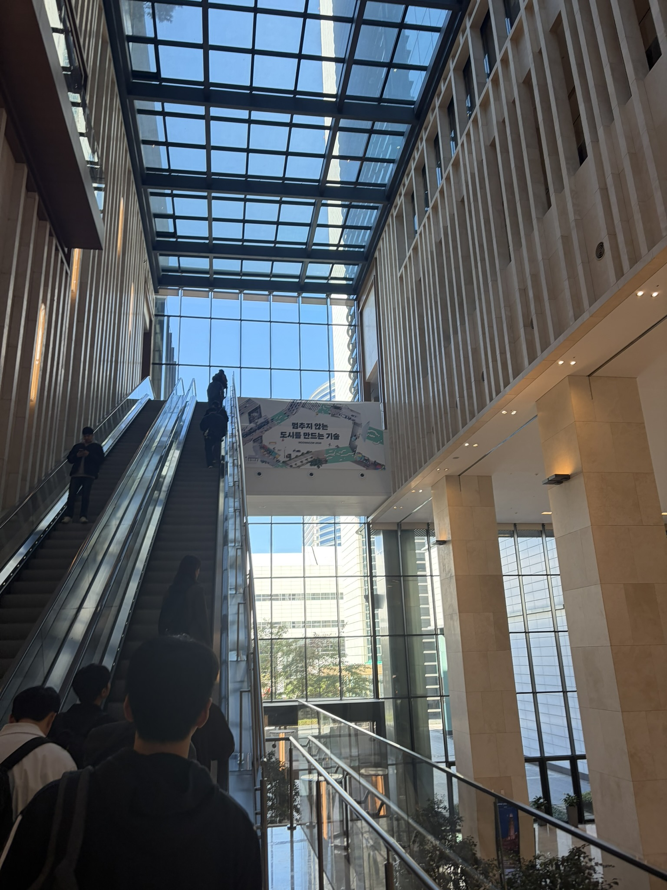
</p>

<br>

입장 이후에는 발송받은 큐알코드를 찍고 명찰과 웰컴키트를 받았다.<br>
그러곤 바로 오프닝 키노트를 들어보고 싶었지만, 조금 늦게와서 그런지 입장제한이 되어 바로 다음 세션부터 듣게 되었다.

<br>

<p align="center">
  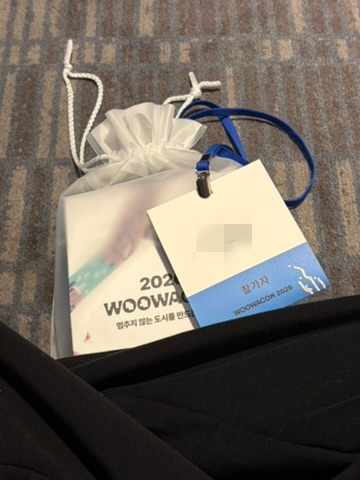
</p>

<br>

원래는 백엔드 세션만 들으며, 배민같은 큰 회사는 백엔드의 기술적인 문제를 어떻게 해결하는지 들어보려고했는데,<br>
첫 세션을 들은 이후로 생각이 바뀌어 계속 연계되는 내용??을 들으며 몰입감있게 듣고싶어져서,<br>
하나의 기능에대해 기획과 개발로 나뉘어있는 세션들을 듣게 되었다.

<br>
<br>

그렇게 첫시간에는 <신입개발자는 이제 필요없나요?>라는 세션을 듣게 되었다.<br>
(메모를 기반으로 기억을 되집으며 작성한거라 일부 맞지 않는 게 있을 수도 있으며 구체적인 내용은  -2026우아콘 영상 시청-)

<br>
<br>

### 목차

- [신입개발자는 이제 필요 없나요?](#신입개발자는-이제-필요-없나요)
- [이 주문 어디서 죽었어요? 배민주문 Temporal 전환기](#이-주문-어디서-죽었어요-배민주문-temporal-전환기)
- [기획대로 안 움직이는 제품 기획하기: 배민 AI 검색 도입기](#기획대로-안-움직이는-제품-기획하기-배민-ai-검색-도입기)
- [확률적 모델 위에 결정적 시스템: 배민 에이전트 개발기](#확률적-모델-위에-결정적-시스템-배민-에이전트-개발기)
- [배민 검색이 AI 검색이 되기까지](#배민-검색이-ai-검색이-되기까지)
- [후기](#후기)

<br>
<br>

## 신입개발자는 이제 필요 없나요?

<p align="center">
  
</p>

<br>

(정신이 없어서 사진은 못 찍음)현재 대학생이며 졸업하자 취준생의 신분이 되는 사람으로써 듣지 않을 수 없는 주제였다.

실제로 내용도 빠르게 변화하는 또는 변화된 시대에 신입에게 요구하는것 그리고 그러한 역량을 키우기위해 어떻게 해야하는가에대해<br>
발표자님의 생각을 설명해주시는데, 너무나도 설명을 잘 해주셔서 앞으로의 방향성을 잡는데에 있어 좋은 시간이 되었던거같다.

<details>
  <summary>세션 내용</summary>

  <br>

  결론 부터 말하면
  신입은 여전히 필요하다고 한다. 다만 **믿고 맡길 수 있는 신입**이 필요하다고 하며,<br>
  최근 3년간 신입 채용이 줄어서 더 신중하게 뽑는다고 한다.
  
  믿고 맡길 수 있다는 건 곧 **경력**(끝까지 해본 경험)이 있다는 뜻인데, 이제는 신입에게도 경력 질문을 하는 시기가 됐다고한다.<br>
  그리고 우테코에서는 이 경력을 교육으로 만들려고 하고있다고한다.

  현업인에게 좋은 신입과 안좋은 신입에 대해 물어보니<br>
  좋은 신입은 보통 무언가에 대해 처음부터 끝까지 맡아서 해본사람이 잘 하더라 라는 말을 해주시고<br>
  그렇지 않은 경우에는 하나의 예시를 들어주시며 설명을 해주셨다고 했는데,<br>
  당시 쿠폰 개선 작업을할때 테스트 500개를 손으로 했었는데, 이에대한 맥락을 잘 파악하지 못하며 실수가 잦았다라는 말을 해주셨다라고 하셨다.

  그리고 면접의 경우 포트폴리오의 프로젝트에 대한 질문을 하는경우가 많은데,<br> 이때 어려운점이 없었느냐라고 물어보는 질문에는 본인이 처음부터 끝까지 해보는 과정에서 생긴 문제들과 같은 일에대해 말을 해주어야하며,<br> 
  또한 이 기능을 왜 만들었나 굳이 필요한가? 적절한가? 시기가 적절했는가? 등의 질문에 답을 할수있어야한다고 한다.

  결국 처음부터 끝까지 해보는것이 중요하며,<br>
  즉 기획부터 검증까지 제품을 만드는 과정 전체를 경험 해야한다.
</details>

<br>
<br>


## 이 주문 어디서 죽었어요? 배민주문 Temporal 전환기
<p align="center">
  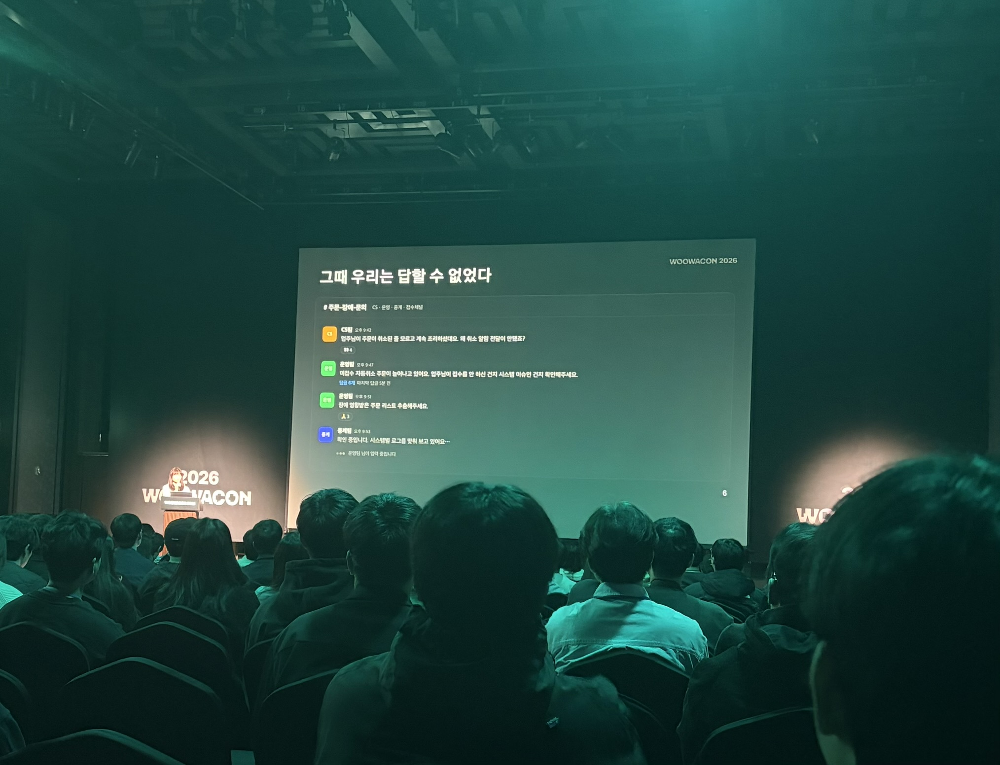
</p>

<br>

이 세션은 주문이 죽었을 때 중계시스템팀이 어디서 멈췄는지 찾기 위해 주문팀, 중계시스템팀, 접수채널팀의 로그를 하나씩 맞춰 봐야 했었는데, 이때 메시지만 전달하는 구조로는 주문이 어디서 멈췄는지 알 수 없었고, 그래서 주문 상태를 중앙에서 계속 기록했어야 하는 불편을 해결하는 내용의 세션이였다.

이러한 문제는 기존에 마이크로서비스끼리 이벤트 기반으로 통신해 주문을 처리했는데, 서비스가 늘면서 주문 흐름을 추적하고 장애 원인을 찾기가 점점 어려워졌다는 배경에서 나왔다고 한다.

그리고 이는 Temporal로 개선하였는데, 특정 과거 시점의 데이터 상태를 기록해 두고 주문이 죽었을 때 거기서부터 다시 시작할 수 있는 시스템으로 변경하였고, 시스템 중단이나 외부 장애가 있어도 처리를 이어갈 수 있도록 주문 처리 이력을 영속적으로 관리하는 구조라고한다

Temporal이라는 단어는 이번에 처음 들어서 듣는데 불편함이 있을까 생각했지만, 처음 듣는 사람을 위해 친절하게 설명해 주셔서 큰 불편 없이 들을 수 있었다.

<details> 
  <summary>세션 내용</summary>

  <br>

  Temporal에 대해 사전설명을 하면 하나의 주문 흐름을 워크플로우라고 하며,
  <br>
  주문 정보 수집 → 업주님께 전달 → 접수 대기 → 배달 요청 순서가 주문의 워크플로우이고, 각 단계의 실제 작업은 Activity가 처리한다. 실행할 작업은 Task Queue에 쌓이고, Worker가 이를 꺼내서 실행하게된다.
  >서비스는 마이크로서비스 4개와 DB로 구성되어 있고, 서비스마다 자기 정책에 따라 따로 스케일한다고 한다.
  
  중계시스템팀은 중계라는 이름 때문에 뭘 중계하는것인지 궁금했었는데, 실제로는 주문에서 파생된 이벤트를 배민의 주요 서비스에 보내주는 팀이었다. 그래서 장애가 나면 주문팀, 접수채널팀과 함께 로그를 맞춰야 한다는것을 알았다.

  문제는 도메인마다 자기 큐와 리스너 서비스가 36개 이상 있다는 점이며. 메시지만 전달하는 구조에서는 주문이 어디서 멈췄는지 알 수 없어서, 주문 상태를 중앙에서 계속 기록해야 했다고한다. 실제로 업주님이 취소된 주문을 모르고 계속 조리하셨는데, 취소 알림이 전달되지 않은 장애도 이런 구조에서는 원인을 찾기 어려웠다고 했다.
  
  Temporal은 이 문제를 오케스트레이션으로 해결한다고 한다. 업주의 주문 접수 같은 외부 이벤트는 Signal로 전달받고, 접수를 기다리는 동안 워크플로우는 멈춰 있다가 Signal을 받으면 다음 단계로 넘어가고, 시스템이 죽어도 워크플로우의 상태가 남아 있어서 주문은 계속 진행됩니다.

  예를 들어 1, 2단계가 잘 끝나고 3단계에서 장애가 났다면, Replay로 실행 이력을 따라가며 1, 2단계는 다시 실행하지 않고 3단계부터 재개해 4단계까지 진행합니다. 덕분에 주문이 죽어도 로그를 맞출 필요 없이 어디서 멈췄는지 바로 찾고 빠르게 해결할 수 있게 되었다고 합니다.
  
  그리고 지금의 나로선 특정 기술을 사용해보고싶어서 또는 좋아보여서라는 느낌이 강한 반면 위와같이 문제가 발생하고 그 문제를 정의하고 거기에 맞추어 기술을 탐색 후 적절하게 도입을 한다는 점에서 매우 인상 깊은 세션이였다. 

</details>

<br>
<br>

## 기획대로 안 움직이는 제품 기획하기: 배민 AI 검색 도입기

<p align="center">
  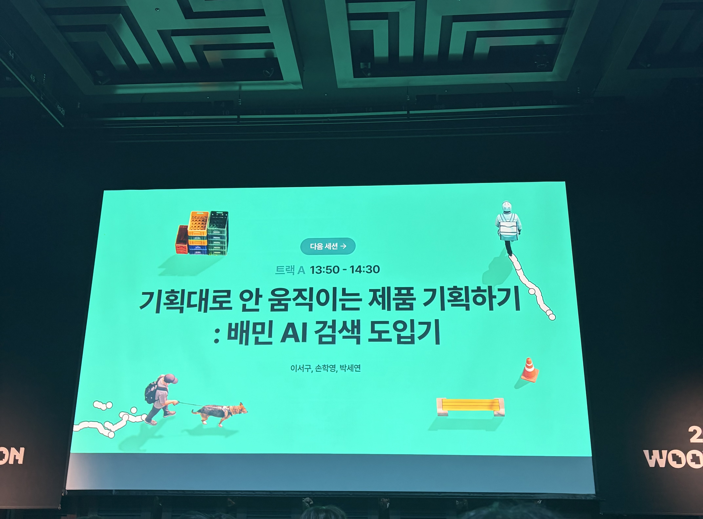
</p>

<br>

이 세션은 기획부분임에도 불구하고 도입부터 바로 뒤에있을 세션의 구현까지 몰입감있게 들어보고 싶어서 듣게되었는데
결론부터 이야기하면 정말 듣기 잘한거같다. 원래 언제가 에이전트를 만들어서 도입해보고 싶었기도 하고 또 이걸 들어서인지 이후 뒤에 있는 구현 단계 세션이 이해가 더욱 잘되는 느낌을 받았다.

그리고 그와 별개로 PM분들과 QA분들이 얼마나 고생해주시는지에 대해 간접적으로 알 수 있는 계기가 되었고,
말씀해주신 내용도 정말 흥미로웠다. 

AI를 어떻게 제어하며 서비스에 도입하려고 하였는지의 노력이 보였으며,
어떻게 문제를 해결했는지까지의 과정이 재미있었다. 그래서 그런지 메모한 내용은 의외로 들었던 세션 중에 가장 길었다.

<details>
  <summary>세션 내용은 여기를 클릭.</summary>

  <br>

  배민 AI 검색은 고객이 막연하게 가진 니즈를 구체화하고, 여러 UI 기능을 조작하며 필터링하는 과정을 AI가 도와주는 기능이며, 고객이 뇌를 많이 써야 하는 지점, 즉 니즈를 구체화하는 단계와 필터링 단계에 AI를 도입했고, 대화로 고객이 원하는 것을 더 쉽게 발견하도록 하는 것이 목적이었다고 한다.
  
  확률론적 제품은 기획 → 구현 → 검증 → 배포 순서가 잘 맞지 않았으며, 개발자는 "동작하나요?"라고 묻고, QA는 "했다 안 했다 하는데요?"라고 답하는 상황이 생겼다고 했다.<br>
  때문에 PM의 역할도 바뀌었다고했으며, 확률론적으로 기대 동작을 정의하고, 판단을 AI에게 어디까지 맡길지, 무한히 다양한 발화를 어디까지 맡길지를 정해야 했다고 한다.
  
  처음에는 좋은 지침과 똑똑한 모델이면 충분하지 않을까라는 생각을 했지만, 고지능 모델(Fable, Astra)은 비싸서 모든 대화에 쓸 수 없었고, 모든 판단을 AI에게 맡기면 결과를 예측하기 어려웠다고 한다.
  <br>
  그래서 한 번에 맡기기에는 맥락이 너무 많아서, 똑똑한 모델 하나에 의존하기보다 더 촘촘하게 설계하는 방향으로 바꿨다고 한다.
  
  기존 결정론적 제품의 정책은 "이 조건이면 이 동작"처럼 조건과 동작이 짝으로 명확하지만 확률론적 제품에서는 표현과 맥락이 달라질 때마다 조건이 계속 늘어났고, 그래서 기대 동작을 정의하는 방식을 세 가지 타입으로 나눴다고 한다.

  <br>
  
  ```text
  직선형: 조건과 동작을 고정한다. AI의 확률 없이 데이터나 시스템 상태로 동작이 결정된다. 예를 들어 가게에 별점 데이터가 있으면 별점 영역을 노출한다.
  
  깔때기형: 입력은 다양해도 특정 의도로 판정되면 정해진 결과로 수렴시킨다. "주문내역 보여줘", "내 주문기록 어디서 봐" 같은 발화가 모두 같은 결과로 모인다.
  
  가드레일형: 입력과 출력은 자유롭게 두고, 지켜야 할 조건과 금지 영역만 정한다. 예를 들어 "반드시 존댓말로 응답한다", "수행하지 않은 동작을 수행했다고 답하지 않는다" 같은 정책이다.
  ```

  <br>

  이렇게 정책을 나누니 예측 불가능한 발화도 결국 예측 가능한 범위로 수렴하게 된다는 것이 핵심이었다. 또한 발화 자체는 정의할 수 없지만 분기는 정의할 수 있고, 무엇을 고정할지(3종 분류), 어떻게 에이전트 워크플로우를 짤지(결정적 동작 위치와 확률적 판단 위치), 어떤 흐름인지(유저 시나리오)를 함께 정의하는 PRD 작업까지 하였다고 한다.
  
  검증도 쉽지 않았다고한다. 대화형 검색은 정답이 하나가 아니고, 정책이 바뀌면 평가 기준도 바뀌어야 했기때문에 처음에는 합격선도 없었고, 없는 가게를 추천하는 것과 없는 메뉴를 추천하는 것이 같은 1건의 오류로 취급되는 문제도 있었다고한다.
  <br>
  결국 사람이 직접 평가하게 되었는데, AI 채점 결과를 믿을 수 없어서 평가 환경을 다시 구성했다고 한다.
  
  이후 지금까지의 과정을 다시 뜯어보며, 원인을 찾아보니 평가 기준이 시나리오마다 흩어져 있었고, AI 채점과 사람의 채점 기준이 달랐다고한다. 그리고 재현되지 않는 변수도 문제였다고 했으며, 발화만 고정하고 계정 상태, 데이터 상태, 모델 변동처럼 답변에 영향을 주는 나머지 요소를 고정하지 않았기 때문에, 같은 조건에서도 결과가 달랐다고 했다. 또 테스트 시나리오가 일반적으로 예상 가능한 범위에서만 만들어져서 실제 고객 상황을 충분히 커버하지 못했다고 한다.
  
  그래서 평가 기준을 상위 개념부터 다시 만들었으며 지켜야 할 것(안전 기준: 거짓 정보 제공 금지, 개인정보 유출 금지)과 잘해야 할 것(품질 기준: 발화 내 조건 충족 여부, 유저 수정 발화 반영 여부)으로 나누었다고 한다. 

  이는 안전 기준은 하나라도 위반되면 불합격이다. 같은 1건의 오류라도 사용자에게 피해를 주는 답변이 있기 때문이며, 품질 기준은 100점 만점으로 점수를 매겼다고 했다.
  <br>
  (정확성 32점, 명료성 24점, 정책 준수 24점, 기대 동작 20점) 합격과 불합격만으로는 두 답변의 차이를 구분할 수 없었기 때문.
  
  이후 AI 채점과 사람 채점이 어긋난 이유를 분석했으며, 원인은 평가 대상 오인식, 정책 미인지, 충족 기준 모호함 등이었고, 이를 바탕으로 평가 프롬프트를 고쳐서 사람과 거의 같은 수준으로 평가하게 되었고, 사람 검토로 평가 일치율을 다시 확인하는 과정을 거쳤다고 한다. (일치율은 개선 전 44에서 개선 후 95로 올라감)
  
  재현이 안 되는 문제는 같은 시나리오를 자동으로 반복 평가하는 방식으로 해결했으며, 테스트 계정을 준비하고, 시나리오 22개를 병렬로 5분 안에 실행하며, 대화 이력을 기록했다고 한다.
  <br>
  배포 기준은 같은 시나리오를 반복 측정했을 때 안전 위반이 0건이고, 품질이 목표 점수 이상이면 배포 가능으로 판단하였다고 하였다.
  
  이번 세션은 메모가 좀 많았는데 언젠가는 한번 에이전트를 만들고 도입해보고 싶지만 아직 그러한 수준까지 오르지도 못하여서 더욱 몰입이 되었던거같고, 가장 기억에 남은 것은 확률론적 제품에서는 기존과 달리 기대 동작을 먼저 정의하면서, 그 기대 동작을 어떻게 검증하는냐에 대한 방법들이 매번 다른 AI의 답변을 통제하는 부분이였다.

</details>

<br>
<br>

## 확률적 모델 위에 결정적 시스템: 배민 에이전트 개발기

<p align="center">
  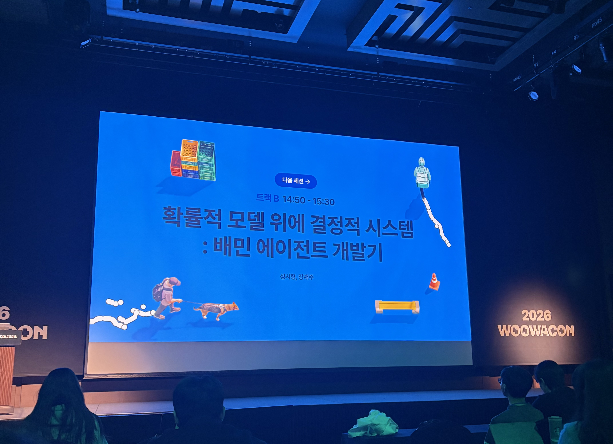
</p>

<br>

이전 기획 세션에서 배민 AI 검색의 기획, 검증, 구현 중 기획과 검증은 듣게되었고, 이어서 이 배경지식으로 구현 세션을 듣게되었는데 정말 듣기 잘한 세션같으며, 추후에 우아콘 영상이 나오면 다시 볼 예정이다. 

이 에이전트를 만드는데 있어서 고민과 문제 그리고 그 문제 해결 방법 등을 순서에 맞춰 소개해주시는데, 발표자님이 설명을 잘 해주시는건지 몰라도 이 세션 내용을 큰 어려움 없이 따라갈 수 있었다고 생각한다. 

또한 평소에 생각했던 이 예측할 수 없는 AI의 문제를 실패 사례와 함께 설명해주시니 더욱 내용을 따라가는데 불편함이 없었던거 같다.

<details>
  <summary>세션 내용은 여기를 클릭.</summary>

  <br>

  **아키텍처 선택**

  <p align="center">
  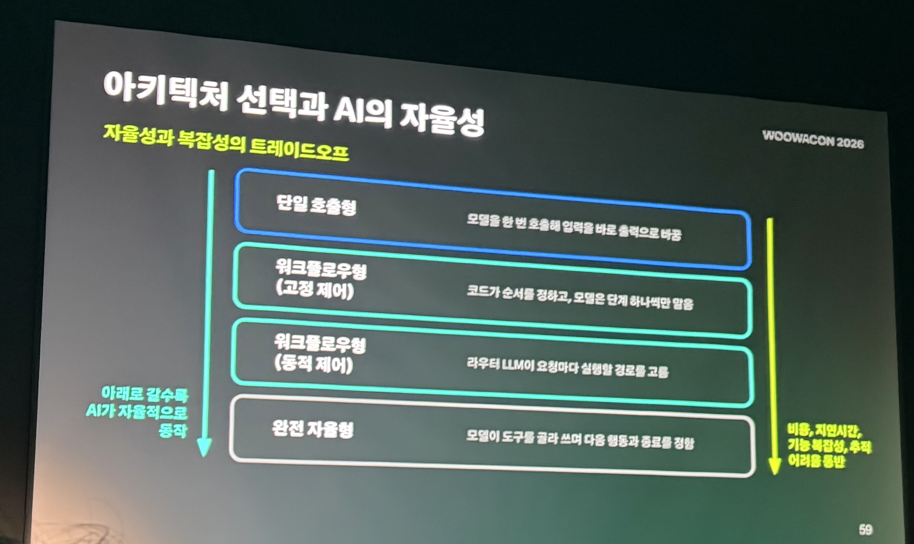
  </p>

  <br>

  에이전트 구조는 자율성 정도에 따라 네 가지로 나눌 수 있다. 단일 호출형은 모델이 한 번 호출되어 입력을 바로 출력으로 바꾸는 방식이고, 워크플로우형(고정 제어)은 코드가 순서를 정하고 모델은 단계별로 하나씩만 호출된다. 워크플로우형(동적 제어)은 라우터 LLM이 요청에 따라 처리 경로를 고르고, 완전 자율형은 모델이 도구를 골라 스스로 다음 행동을 정한다. 자율성이 높아질수록 AI가 스스로 움직이지만, 비용과 지연, 추적의 어려움도 함께 커진다.

  <br>
  <br>

  <p align="center">
  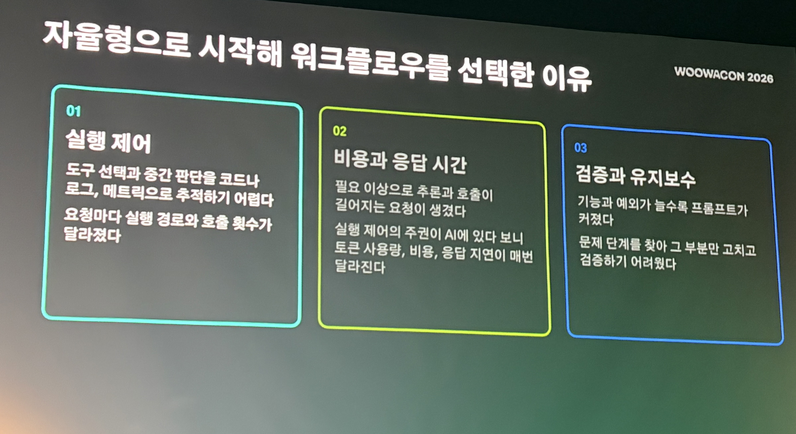
  </p>

   <br>

  처음에는 자율형으로 시작했지만, 실행 흐름이 요청마다 달라서 도구 선택과 호출 횟수를 추적하기 어려웠고, 토큰 사용량과 응답 시간도 매번 달라졌다고 한다. 그래서 정의된 기능을 정해진 절차로 수행하고 조건 안에서 일관된 답변을 주는 워크플로우 패턴을 선택했고, 이는 여러 사람이 유지보수할 수 있도록 흐름이 눈에 보이는 시스템이 필요했기 때문이라고 한다.
  
  <br>
  <br>
  

  **한 턴의 처리 흐름**

  <p align="center">
  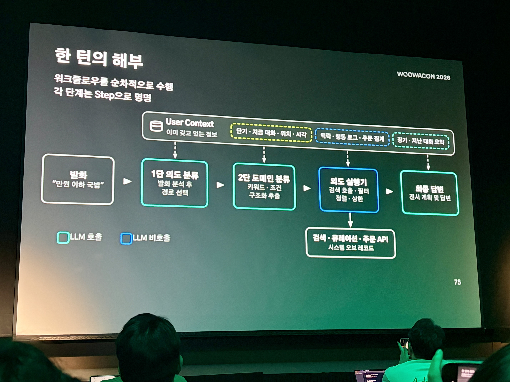
  </p>
  
  <br>

  사용자 발화가 들어오면 1단계 의도 분류에서 LLM이 발화를 분석해 경로를 고른다. 2단계 도메인 분류에서 LLM이 키워드와 조건을 구조화하고, 의도 실행기에서는 LLM 없이 검색, 쿼리, 주문 API를 호출한다. 마지막 최종 답변 단계에서 LLM이 실행 결과와 대화 맥락으로 응답을 만든다. 이때 맥락은 단기(지금 대화, 위치, 시각), 맥락(행동 로그, 주문 정보), 장기(지난 대화 요약)로 나눠서 필요한 시점에만 넘긴다.
  
  <br>

  <p align="center">
  <table>
  <tr>
    <td>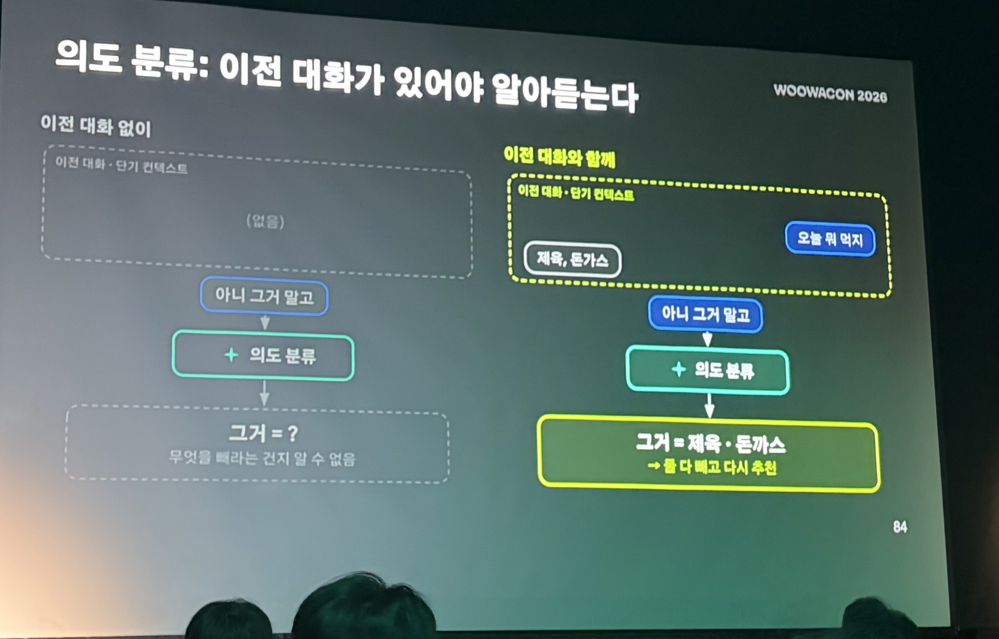</td>
    <td>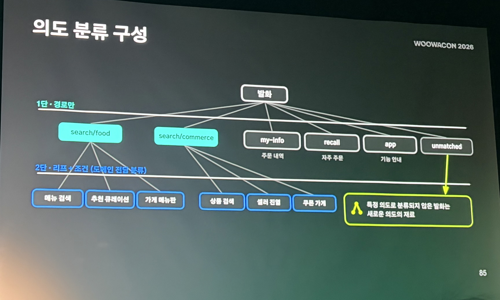</td>
  </tr>
  </table>
  </p>

  <br>

  의도 분류는 이전 대화를 함께 봐야 하는데, "아니 그거 말고"라는 발화만으로는 의도를 알 수 없고, 이전 대화에서 나온 제육이나 돈까스를 가리킨다는 것을 알아야 한다. 의도는 search/food, search/commerce, my-info(주문 내역), recall(재주문), app(기능 안내), unmatched로 1차 분류하고, 그 아래에서 메뉴 검색, 추천, 가게 메뉴판 같은 2차 도메인으로 나눈다. unmatched로 떨어진 발화는 새로운 의도 후보로 모은다.
  
  실행은 특정 의도에 따라 정해진 Handler가 수행한다. 파라미터 일부는 User Context에서 자동으로 넣고, 일부만 AI가 생성한다. validation과 재시도 정책은 구현체마다 다르다. 발표 예시 코드는 MenuSearch 핸들러가 위치를 주입받고, 키워드는 AI가 만든 뒤 검색 API를 최대 3번 재시도하는 구조였다.
  
  <br>
  <br>

  **실제 실패 사례**
  
  <p align="center">
  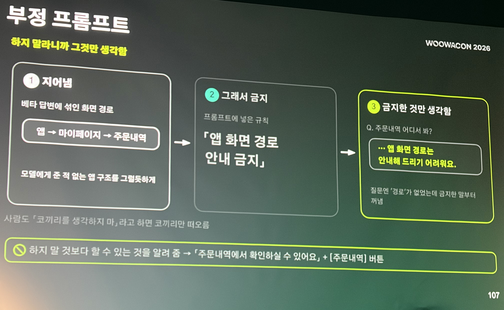
  </p>

  <br>

  프롬프트를 고칠 때마다 생긴 문제들도 소개되었다. 칩 버튼을 누르면 빈 출력이 나오는 경우가 있었고, "하지 말라"는 부정 프롬프트는 오히려 그 내용을 떠올리게 만들었다고 한다. 예를 들어 "앱 화면 경로 안내 금지"를 넣으니 "앱 화면 경로는 안내해 드리기 어려워요"처럼 금지한 말만 계속 나왔고 그래서 하지 말라는 규칙 대신 할 수 있는 행동을 알려주는 방식으로 바꿨다고하며, "주문내역에서 확인하실 수 있어요"와 [주문내역] 버튼을 주는 식이라고 한다.
  
  <br>

  <p align="center">
  <table>
  <tr>
    <td>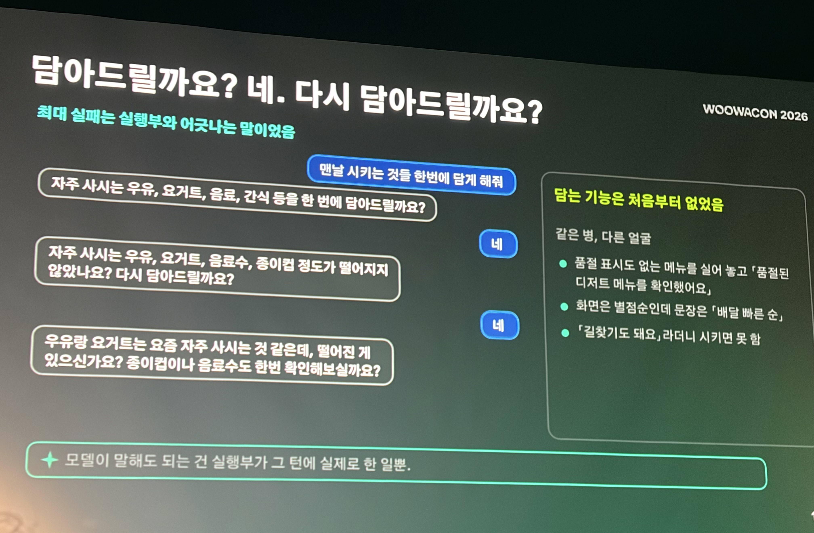</td>
    <td>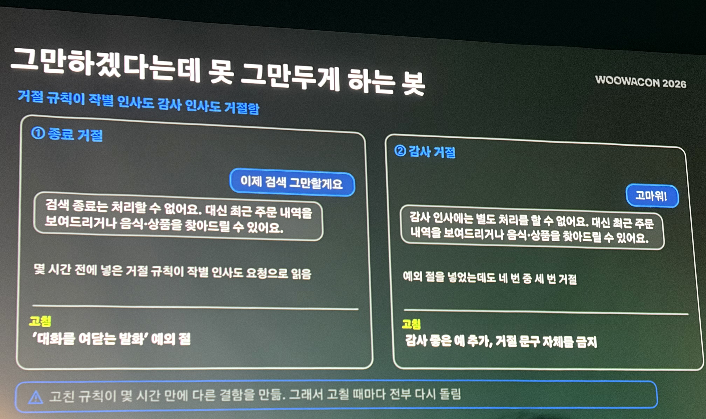</td>
  </tr>
  </table>
  </p>
  <br>

  "맨날 시키는 것을 한 번에 담아줘" 요청에는 담기 기능 자체가 처음부터 없었으며, 이에 모델이 말해도 되는건 실행부가 그 턴에 실제로 한 일로 제한 해야 한다라는것을 알았고, 종료 거절 규칙도 같은 문제였다고 한다. "이제 검색 그만할게요"를 처리하지 못하게 막으면서 작별 인사까지 거절하는 봇이 되었고, 예외 조항을 넣어도 몇 시간 뒤에 다른 결함이 생겼으며, 그래서 규칙을 고칠 때마다 전체 시나리오를 다시 돌렸다고 한다.
  
  <br>
  <br>

 **테스트와 운영 루프**
  
  <p align="center">
  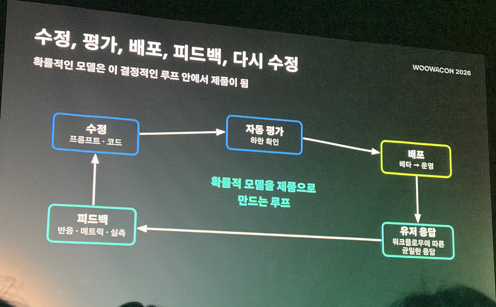
  </p>

  <br>

  수정한 프롬프트와 코드는 바로 배포하지 않으며, 의도별 발화 케이스를 세팅하고, LLM-as-a-Judge로 결과를 채점해 품질 점수를 낸다. 그다음 Judge 점수와 사람의 판정을 비교해서 채점기 자체를 신뢰할 수 있는지 점검한다. 배포 후에는 베타에서 운영으로 넘기고, 실제 유저 반응과 메트릭을 다시 피드백해서 수정으로 돌아간다라는 이 루프가 확률적인 모델을 제품으로 만드는 방식이라고 한다
  
  <br>
  <br>

 **LLM 선택과 비용**
  
  <p align="center">
  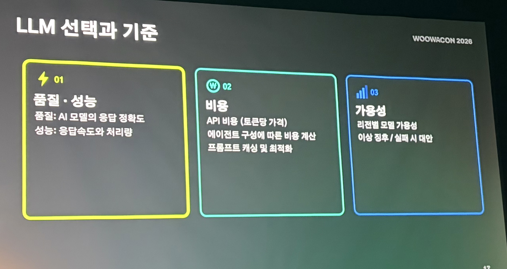
  </p>

  <br>

  LLM은 품질과 성능, 비용, 가용성을 기준으로 골랐다고 하며, 품질은 의도 이해, 사실 정확성, 기대 동작, 표현과 정책을 기준으로 보고, 성능은 응답 속도, 처리량, 실패율, 지연 시간을 본다고 했다.<br>
  비용은 프롬프트 캐시를 고려해 시스템 지시, 개인화 맥락, 요청별 내용 순서로 구분했다고 하며, 이는 캐시가 유지되는 앞부분을 고정해야 비용이 줄기 때문이라고 했다.<br>
  가용성은 주요 API가의 지연이 늘어나는 시간대에 메인 모델(GPT-5.6 Luna)에서 자체 호스팅 모델(Gemma 4)로 전환하는 다중 모델 구조를 택했다고 한다.
  
  <br>
  <br>

  **확률적으로 답하는 모델 위에, 어떻게 결정적인 시스템을 세우는가**
  
  <p align="center">
  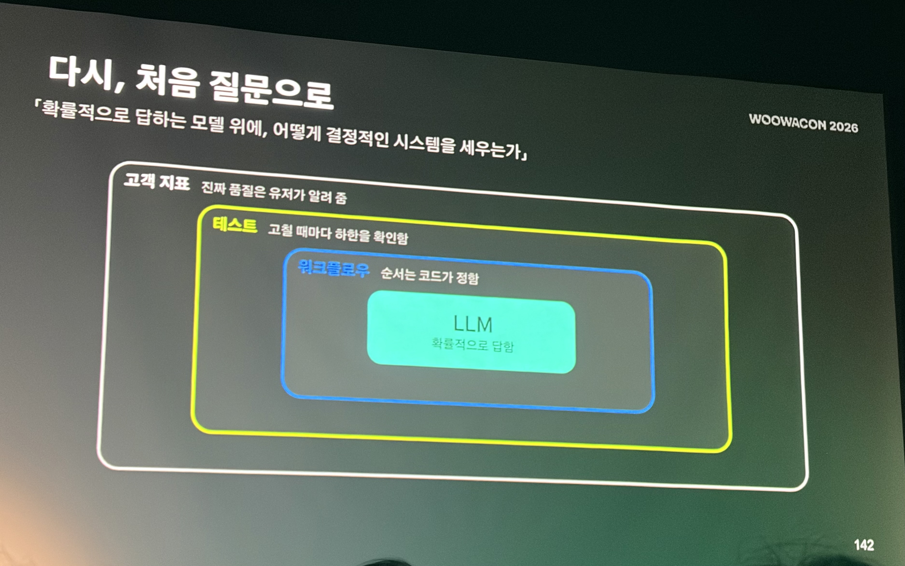
  </p>

  <br>

  확률적으로 답하는 모델위에 적절한 워크플로우를 택하고 테스트를 통해 "**하한**"을 지키며, 고객으로 부터 지표를 얻어 이를 피드백한다.

  <br>

  정리하면 적절하게 선택한 LLM에 판단을 맡기되, 실행과 흐름은 코드가 정하고 그 결과를 계속 테스트하고, 유저 운영 피드백으로 계속 검증하는 구조를 반복하며 이상적인 결정적 시스템을 세운다고 볼 수 있는거같다.
</details>

<br>
<br>

## 배민 검색이 AI 검색이 되기까지

<p align="center">
  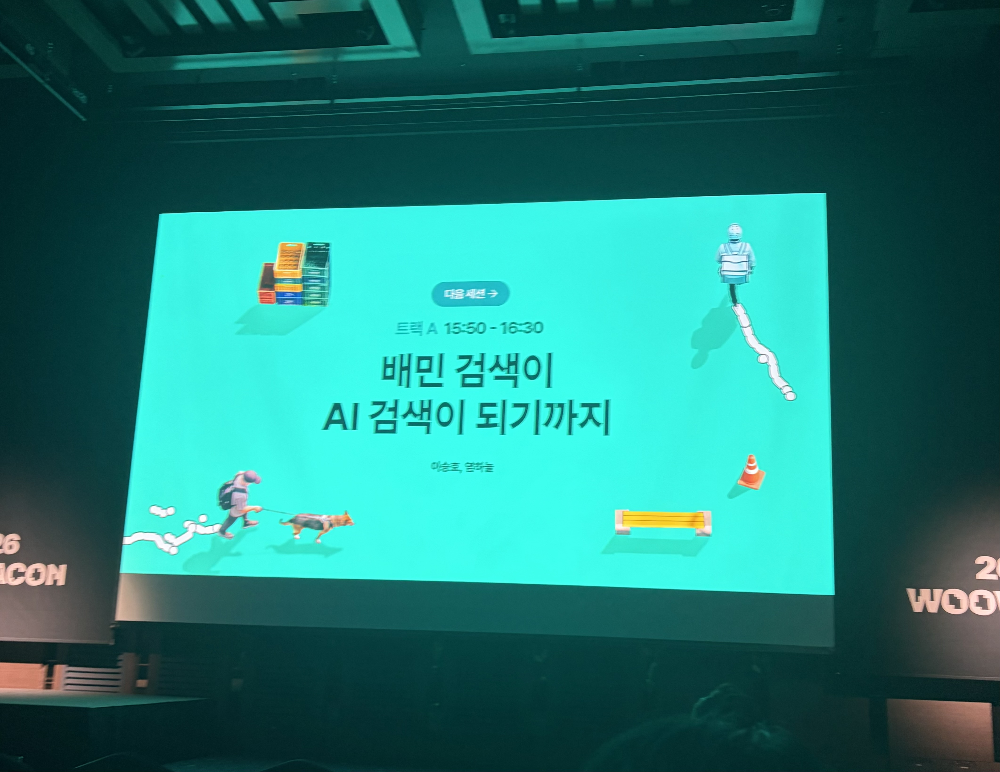
</p>

<br>

이 세션부터는 집중력이 떨어져 메모를 하지 못해 기억나는 내용을 바탕으로 정리했다.

백엔드 시스템의 이상적인 기본 구조는 사용자가 서버에 요청하고, 서버가 검색엔진에서 결과를 받아 응답하는 단순한 형태이지만, 현실은 서비스가 커지면서 그 사이에 시맨틱 검색과 대화형 검색 등 여러 단계가 추가되고, 그만큼 전체 과정이 복잡해졌다고한다.<br>
이렇게 되면 검색 결과가 제대로 나오는지 처음부터 끝까지 종단간 한 번에 확인할 방법이 없어지는 문제가 생기는데, 이는 어느 단계에서 품질이 떨어졌는지 알기 어렵기 때문이라고 한다.

그리고 이 문제를 해결하기 위해 검색 결과 전체를 평가하는 인프라를 만들었다고 하며, 이는 골든셋을 준비하고, LLM이 결과를 채점하도록 해서 품질을 확인하는 방법이라고 한다.

예시로 정식 이름이 아닌 단어로 검색했을 때의 차이를 보여주셨는데, 다이어트 과자를 검색하면 기존 화면은 과자에 초점을 맞춰 홈런볼을 보여준 반면, 개선한 화면에서는 단백질 과자가 나온것을 보여주셨다.

<br>
<br>

## 후기

<p align="center">
  
</p>

<br>

솔직히 내 주변에는 같은 분야를 공부하는 사람이 많지 않아서, 공부할 때마다 지금 잘하고 있는 게 맞는지 불안할 때가 많았는데, 우테코 분들을 포함해서 같은 분야를 공부하는 사람들이 이야기하는 것을 듣고, 사람들이 얼마나 열정을 가지고 열심히 공부하는지, 또 컨퍼런스에 참여했는지 간접적으로 느낄 수 있는 좋은 기회였다.

또 번아웃이 올 것 같던 시기에 오히려 동기부여가 되었으며, 새로운 기술을 접하면서 시야가 넓어지는 느낌도 받았고, 다음에는 더 공부한 뒤에 다시 참여할 기회가 있었으면 좋겠다.

번외로 이런 큰 IT 회사들이 실제로 문제를 어떤 방식으로 해결하는지 궁금했는데, 이번 기회에 그 과정을 간접적으로 볼 수 있어서 좋았고, 확실히 영상으로 보는 것보다는 실제로 참여해서 듣는 것이 집중이 잘되는 것 같긴 하다.